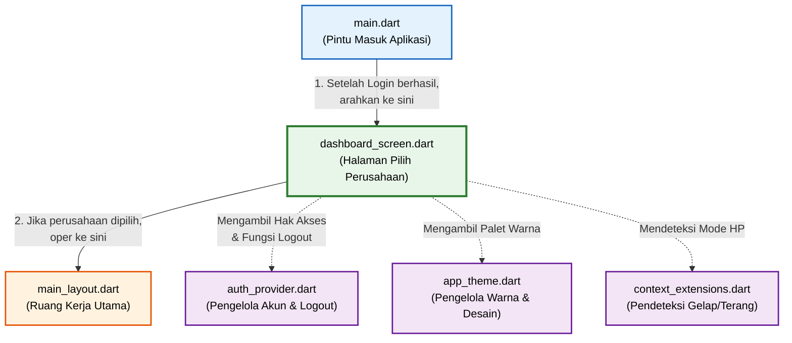

# Alur Koneksi `dashboard_screen.dart`

Berikut adalah diagram visual yang menunjukkan bagaimana file **`dashboard_screen.dart`** terhubung dengan file-file lainnya di dalam aplikasi Anda.

> [!NOTE]
> * Garis penuh (panah solid) menunjukkan **Alur Perpindahan Layar** (Navigasi).
> * Garis putus-putus menunjukkan **Pengambilan Data / Bantuan** (Dependency).
