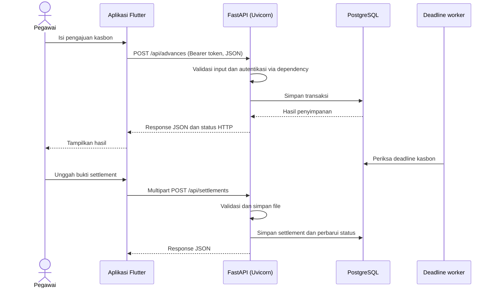

# Peta Skill: Python, FastAPI, dan Flutter untuk EWIApps

Kurikulum ini menggantikan materi Flask lama. Backend aktif EWIApps menggunakan **FastAPI + SQLAlchemy + Alembic**; frontend menggunakan **Flutter/Dart**. Flask tidak menjadi skill yang perlu dipelajari untuk pengembangan fitur baru. Jejak Flask pada snapshot atau catatan lama bersifat historis.

## A. Skill Python (Backend dan Pengolahan Data)

### 1. Fondasi Python

- Tipe data, string, angka, list, tuple, set, dan dictionary.
- Percabangan, perulangan, fungsi, parameter, return value, dan comprehension.
- Exception handling, logging, modul, virtual environment, dan konfigurasi environment.
- `datetime`, timezone, dan pemrosesan tanggal.
- JSON dan serialisasi data.

### 2. OOP dan struktur aplikasi

- Class, object, constructor, method, dan composition.
- Type hints dan pemisahan router, service, model, schema, serta utility.
- Membaca alur kode yang sudah ada sebelum mengubahnya.

### 3. FastAPI (REST API)

- Membuat aplikasi FastAPI dan menjalankannya dengan Uvicorn/ASGI.
- `APIRouter`, path operation (`GET`, `POST`, `PUT`, `PATCH`, `DELETE`), tag, dan prefix.
- Path parameter, query parameter, request body, header, cookie, dan response.
- Pydantic untuk validasi input/output; pahami juga endpoint yang memakai parameter FastAPI langsung.
- `HTTPException`, status code, response model, dan penanganan error.
- Dependency injection dengan `Depends`, termasuk dependency session database.
- OpenAPI dan Swagger UI (`/docs`) untuk melihat serta mencoba kontrak API.
- Upload/download berkas dengan `UploadFile`, `File`, dan `FileResponse`.
- Konfigurasi CORS dan middleware sesuai kebutuhan aplikasi.

**Rujukan EWIApps:** `backend/main.py`, `backend/routes/`, `backend/schemas/`, dan `backend/core/`.

### 4. Autentikasi dan keamanan

- HTTP bearer token, JWT, masa berlaku token, dan pemeriksaan role.
- PyJWT dan dependency autentikasi FastAPI yang digunakan proyek.
- Hash/verifikasi password serta pengelolaan secret lewat konfigurasi environment.
- Validasi input dan pembatasan akses file/API.

JWT masih dipakai dengan sengaja di aplikasi; JWT bukan ketergantungan Flask. Jangan mengganti pola auth tanpa mempertahankan kompatibilitas token dan password yang sudah ada.

### 5. SQLAlchemy, PostgreSQL, dan Alembic

- Model, relasi, foreign key, query SQLAlchemy, session, dan transaksi.
- Commit/rollback dan lifecycle session melalui dependency.
- PostgreSQL dan konfigurasi koneksi.
- Alembic untuk membuat, meninjau, dan menjalankan migrasi skema.
- EWIApps memiliki adapter kompatibilitas SQLAlchemy internal untuk sebagian pola model lama (`db.Model`, `db.Column`, dan `.query`). Pelajari implementasinya di `backend/models/base.py` dan `backend/core/database.py`; adapter ini bukan Flask-SQLAlchemy dan tidak menjalankan Flask.

**Rujukan EWIApps:** `backend/core/database.py`, `backend/models/`, dan `backend/migrations/`.

### 6. Layanan aplikasi dan file

- Service Python menerima argumen eksplisit; jangan mengambil request global dari service.
- Penyimpanan dan validasi bukti transaksi.
- OpenPyXL/XlsxWriter untuk Excel, ReportLab untuk PDF, dan Pillow untuk gambar.
- Worker/background task dan email mengikuti implementasi serta konfigurasi proyek.
- Pandas/NumPy untuk script analisis dan audit data.

**Rujukan EWIApps:** `backend/services/`, `backend/utils/`, dan `backend/scripts/`.

## B. Skill Flutter dan Dart (Frontend)

### 1. Bahasa Dart

- Tipe data, `List<T>`, `Map<String, dynamic>`, null safety, class, dan extensions.
- `Future`, `async`/`await`, `Stream`, serta serialisasi model JSON.

### 2. UI dan state

- Widget, layout, navigasi, form, validasi, tabel, dialog, dan tema.
- Provider: `ChangeNotifier`, `notifyListeners`, `context.watch/read`, dan `Consumer`.

### 3. Format dan perangkat

- Intl untuk format mata uang dan tanggal.
- File picker/image picker, path provider, pembukaan file hasil download, dan konfigurasi desktop.

### 4. Integrasi API

- HTTP `GET`/`POST`/`PUT`/`DELETE`, JSON, query parameter, dan multipart upload.
- Base URL, header `Authorization: Bearer <token>`, timeout, status code, serta penanganan error.
- Menelusuri alur screen → provider/controller → service API → endpoint FastAPI.

**Rujukan EWIApps:** `frontend/lib/services/`, `frontend/lib/screens/`, dan `frontend/lib/providers/`.

## C. Alur Bisnis: Kasbon dan Settlement



## D. Prompt Belajar yang Diperbarui

```text
Saya sedang mempelajari aplikasi EWIApps dengan arsitektur:
- Backend: Python, FastAPI, Uvicorn, SQLAlchemy, Alembic, PostgreSQL, dan PyJWT untuk bearer authentication.
- Frontend: Flutter/Dart dengan Provider dan HTTP client.
- Fitur: transaksi kasbon/settlement, upload bukti, laporan Excel/PDF, serta audit data.

Bimbing saya langkah demi langkah mulai dari Python dasar, lalu FastAPI dan integrasi Flutter. Gunakan contoh yang relevan dengan transaksi keuangan. Jelaskan request/response HTTP, APIRouter, Pydantic, Depends, SQLAlchemy, autentikasi JWT, dan upload file. Tunjukkan file EWIApps terkait bila cocok, berikan latihan kecil, dan jangan memakai Flask atau Flask extension sebagai pola implementasi.
```
