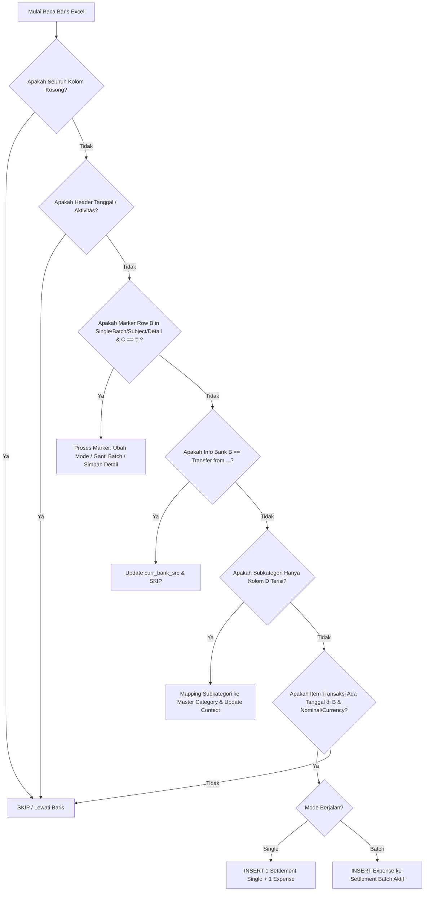

# Dokumentasi Perubahan Parser Excel V14 (generate_hybrid_migration_v14.py)

Dokumen ini mencatat secara menyeluruh perbaikan logika pembacaan dan pemetaan (*mapping*) data file Excel ke database PostgreSQL pada skrip:
📂 `backend/scripts/generate_hybrid_migration_v14.py`

Sumber data Excel yang digunakan:
📄 `data/excel/20250427_EWI Financial-Repport_2024-2026 (version 2).xlsx`

---

## 1. Latar Belakang & Tujuan Perubahan

Pada pembaruan file Excel versi terbaru, struktur data untuk seluruh tahun (**2024, 2025, dan 2026**) telah distandardisasi menggunakan penanda eksplisit (*marker*) pada baris:
* `Single : OPERATION COST AND OFFICE`
* `Batch : OPERATION COST AND OFFICE`
* `Subject : [Nama Batch / Judul Dokumen]`
* `Detail : [Keterangan Tambahan]`

Namun, skrip `generate_hybrid_migration_v14.py` sebelumnya masih menggunakan logika lama berbasis deteksi visual (gaya font seperti Arial/Calibri Bold, warna cell/solid fill, dan heuristik multi-kondisi) yang dibuat saat struktur sheet antar tahun berbeda-beda. Hal ini menyebabkan inkonsistensi pembacaan data, item yang terlewat, dan kesalahan klasifikasi antara Single dan Batch.

Tujuan utama perubahan ini adalah:
1. Menyeragamkan cara membaca data Excel di ketiga sheet (2024, 2025, 2026) secara konsisten dan deterministik.
2. Mengganti deteksi font/warna yang rapuh dengan *state machine* berbasis marker teks eksplisit.
3. Memastikan pembacaan Subkategori, Isian (Single & Batch), Subject, dan Detail akurat sesuai struktur kolom Excel yang sebenarnya.
4. Menjaga integritas data di database (`settlements`, `expenses`, `expense_subcategories`).

---

## 2. Perbandingan Kondisi: Before vs After

| Aspek | Kondisi Sebelum (Before) | Kondisi Sesudah (After) | Alasan Perubahan |
| :--- | :--- | :--- | :--- |
| **Metode Deteksi Mode (Single / Batch)** | Menggunakan fungsi `is_divider_row()` yang membaca font `Arial Narrow`, teks `"OPERATION COST"`, dan cell background fill (`solid fill`). | Menggunakan fungsi `_is_marker_row()` yang memeriksa pasangan kolom: `Kolom B == 'Single' / 'Batch'` dan `Kolom C == ':'`. | Font dan warna fill tidak seragam di semua tahun (2024 berbasis teks, 2025/2026 berbasis fill). Marker teks eksplisit ada di seluruh tahun. |
| **Deteksi Awal Batch Settlement** | Mendeteksi baris font 10pt Bold (`_is_subcategory_cell`) atau status `expecting_batch_title` dan `is_manual_group`. Sering tertukar antara Subkategori dan Judul Batch. | Mendeteksi baris `Kolom B == 'Subject'` dan `Kolom C == ':'`. Isi Kolom D langsung dijadikan judul settlement batch. | Pemisahan tegas: `Subject :` mutlak penanda awal batch settlement baru, bukan subkategori. |
| **Deteksi Keterangan Tambahan** | Sering dianggap baris item pengeluaran kosong, subkategori liar, atau diabaikan. | Mendeteksi baris `Kolom B == 'Detail'` dan `Kolom C == ':'`. Kolom D disimpan sebagai pelengkap konteks batch aktif. | Baris `Detail :` bukan batch baru dan bukan pengeluaran; ini metadata penjelas dari batch berjalan. |
| **Deteksi Subkategori** | Mengandalkan properti font `Arial` / `Calibri` 10pt Bold (`_is_subcategory_cell`). Jika format font bergeser atau tidak bold, subkategori gagal terbaca. | Menggunakan aturan struktural kolom `_is_subkategori_row()`: **Hanya Kolom D yang terisi**, sedangkan Kolom B, C, E, F, G kosong. | Format font di Excel rawan tidak konsisten. Secara struktur tata letak, subkategori selalu berdiri sendiri di Kolom D tanpa nilai transaksi. |
| **Validasi Item Pengeluaran (Isian)** | Kaku: Mengharuskan Kolom B bertipe tanggal **DAN** Kolom C harus berupa angka urut integer (`val_c.isdigit()`), serta hanya menerima currency `"IDR"` atau `"USD"`. | Fleksibel & Akurat: Kolom B harus bertipe tanggal valid; Kolom C (nomor) bersifat **opsional**; currency menerima `"IDR"`, `"USD"`, `"RP"`, `"MYR"`, atau string kosong (default ke IDR). | Di Excel 2025 terdapat banyak transaksi pengeluaran sah yang Kolom C-nya tidak diisi angka urut, atau menggunakan simbol mata uang `"Rp"` / `"MYR"`. Jika Kolom C wajib diisi angka, puluhan transaksi valid hilang. |
| **Penanganan Baris Kosong** | Kadang memicu pembuatan settlement draft palsu atau error mapping kategori. | Baris di mana seluruh kolom B s/d G kosong langsung dilewati (`continue/skip`) tanpa mengubah state sistem. | Menghindari pembuatan data sampah (*garbage records*) di database. |
| **Arsitektur Loop Utama** | Memiliki percabangan ganda rumit dengan variabel bendera (*flags*) seperti `is_manual_group`, `expecting_batch_title`, `is_solid_row`, `is_subcat_for_check`. | State machine linier 7 langkah yang teratur, berurutan, dan deterministik. | Mempermudah penelusuran (*traceability*) dan mencegah bentrokan logika antar kondisi. |

---

## 3. Komponen yang Dihapus & Alasannya

1. **`_is_anchor_cell()` (dihapus dari loop migrasi pengeluaran, dipertahankan untuk scan sheet)**
   * *Status:* Tidak lagi digunakan untuk mendeteksi batas tabel Single/Batch pengeluaran (karena sudah digantikan oleh marker `Single :` dan `Batch :`). Namun fungsi ini tetap dipertahankan pada skrip untuk modul `scan_sheet_analysis` dan pembatas mutasi bank.
2. **`_is_subcategory_cell()` (pada loop utama migrasi)**
   * *Alasan dihapus dari loop:* Logika pengecekan font 10pt Bold sering salah mendeteksi teks deskripsi panjang atau melewatkan subkategori yang formatting font-nya tidak sengaja diubah oleh user. Digantikan sepenuhnya oleh pengecekan struktural kolom (`_is_subkategori_row`).
3. **Pemeriksaan `solid fill` / Background Color**
   * *Alasan dihapus:* Tahun 2024 tidak memiliki pewarnaan cell yang sama dengan 2025/2026. Bergantung pada warna cell menyebabkan skrip bekerja di satu sheet namun gagal di sheet lainnya.
4. **Variabel Flags yang Overlap (`is_solid_row`, `expecting_batch_title`, `is_manual_group`)**
   * *Alasan dihapus:* Variabel-variabel ini dibuat untuk mengakomodasi inkonsistensi template lama. Dengan adanya marker standar `Single`, `Batch`, `Subject`, variabel ini tidak lagi diperlukan dan berpotensi menimbulkan bug bila dipertahankan.
5. **Syarat Kaku Nomor Urut di Kolom C (`is_num = str(val_c).isdigit()`)**
   * *Alasan dihapus:* Ditemukan 85 baris pengeluaran sah di tahun 2025 (misalnya pembayaran pajak, tunjangan, transfer operasional) yang memiliki tanggal di Kolom B dan nominal di Kolom F, tetapi Kolom C dibiarkan kosong oleh pembuat laporan. Mengharuskan Kolom C berisi angka menyebabkan data pengeluaran tersebut terbuang.

---

## 4. Komponen yang Diganti / Ditambahkan & Alasannya

1. **Penambahan `_is_marker_row(val_b, val_c)`**
   * *Definisi:*
     ```python
     def _is_marker_row(val_b, val_c) -> bool:
         b = str(val_b or "").strip().lower()
         c = str(val_c or "").strip()
         return b in ("single", "batch", "subject", "detail") and c == ":"
     ```
   * *Alasan:* Memberikan satu gerbang deteksi resmi untuk semua jenis baris penanda navigasi template.
2. **Penambahan `_is_subkategori_row(val_b, val_c, val_d, val_e, val_f, val_g)`**
   * *Definisi:*
     ```python
     def _is_subkategori_row(val_b, val_c, val_d, val_e, val_f, val_g) -> bool:
         d_filled = bool(val_d and str(val_d).strip())
         others_empty = not any([
             val_b and str(val_b).strip(),
             val_c and str(val_c).strip(),
             val_e and str(val_e).strip(),
             val_f and str(val_f).strip(),
             val_g and str(val_g).strip(),
         ])
         return d_filled and others_empty
     ```
   * *Alasan:* Mengimplementasikan aturan bisnis bahwa jika baris hanya berisi teks di Kolom D sedangkan kolom lain kosong, baris tersebut adalah penanda Subkategori.
3. **Penyempurnaan `_is_expense_item(val_b, val_g)`**
   * *Definisi:*
     ```python
     def _is_expense_item(val_b, val_g) -> bool:
         is_date = isinstance(val_b, (dt.date, dt.datetime))
         cur = str(val_g or "").strip().upper()
         is_cur = cur in ("IDR", "USD", "RP", "MYR", "")
         return is_date and is_cur
     ```
   * *Alasan:* Memastikan seluruh transaksi pengeluaran valid terbaca tanpa terhalang ada/tidaknya nomor urut di Kolom C dan variasi penulisan mata uang.
4. **Penyederhanaan `is_divider_row()`**
   * *Implementasi baru:* Hanya memeriksa string kunci `"OPERATION COST AND OFFICE"` tanpa memeriksa atribut font `Arial Narrow`.
5. **Normalisasi Mata Uang**
   * Nilai `"RP"` dan string kosong `""` secara otomatis dinormalisasi menjadi `"IDR"`.
   * Nilai mata uang asing seperti `"MYR"` didukung dengan kurs konversi yang dihitung dari kolom exchange rate.

---

## 5. Aturan Baku Klasifikasi Data (Spesifikasi Parser Baru)

State machine membaca file baris demi baris (*row by row*) dengan urutan evaluasi sebagai berikut:



### 5.1. Aturan Penanda Mode: Single vs Batch
* **Single Mode:**
  * Penanda: Kolom B = `Single`, Kolom C = `:`
  * Perilaku: Mengubah mode internal menjadi `"single"`. Menutup batch yang sedang terbuka. Setiap item transaksi di bawahnya akan dibuatkan satu entitas `settlements` (tipe single) dan satu entitas `expenses` terkait dengan tanggal dokumen persis sesuai tanggal Excel.
* **Batch Mode:**
  * Penanda: Kolom B = `Batch`, Kolom C = `:`
  * Perilaku: Mengubah mode internal menjadi `"batch"`.

### 5.2. Aturan Penanda Batch: Subject vs Detail
* **Subject (Awal Batch):**
  * Penanda: Kolom B = `Subject`, Kolom C = `:`
  * Nilai: Kolom D = Nama Subject / Judul Batch (contoh: `20250308_Form Expenses multi trip Februari_2025_Rev1`)
  * Perilaku: Menutup batch sebelumnya jika ada, lalu membuat record settlement baru bertipe `'batch'`. Seluruh item pengeluaran yang muncul setelah baris ini otomatis menjadi item anak (*child expenses*) dari settlement ini.
* **Detail (Keterangan Batch):**
  * Penanda: Kolom B = `Detail`, Kolom C = `:`
  * Nilai: Kolom D = Deskripsi rincian batch
  * Perilaku: Disimpan ke variabel `curr_detail`. Tidak membuat settlement baru dan tidak memecah batch.

### 5.3. Aturan Baris Subkategori (Hanya Kolom D yang Terisi)
* **Kriteria:** Kolom D memiliki nilai string yang tidak kosong, sedangkan Kolom B, C, E, F, G seluruhnya kosong.
* **Perilaku:**
  1. Teks Kolom D diambil sebagai nama subkategori aktif.
  2. Sistem mencocokkan teks tersebut ke daftar kategori master aplikasi (lihat Bab 6).
  3. Konteks subkategori (`curr_subcat_id` dan `curr_subcat_ids`) diperbarui.
  4. Baris ini selesai diproses dan pembacaan lanjut ke baris berikutnya tanpa membuat transaksi.

### 5.4. Aturan Baris Kosong
* **Kriteria:** Seluruh kolom (B, C, D, E, F, G) tidak memiliki isi (bernilai `None` atau string kosong).
* **Perilaku:** Diabaikan sepenuhnya (*skipped*). Tidak dianggap sebagai isian transaksi dan tidak mereset state batch.

### 5.5. Aturan Isian Transaksi (Item Pengeluaran)
* **Kriteria:** Memiliki tanggal valid di Kolom B, memiliki mata uang/nominal, dan bukan merupakan baris marker/subkategori/header. Kolom C berisi nomor urut atau kosong.
* **Perilaku:**
  * Nominal diambil dari kolom kategori (Kolom 9 s/d 21) atau kolom nominal (Kolom E/F).
  * Di-insert ke tabel `expenses`.
  * `settlements.disbursed_amount` dihitung ulang secara otomatis berdasarkan akumulasi expense di settlement tersebut.

---

## 6. Mekanisme Pemetaan Subkategori ke Kategori Database

Di dalam file Excel laporan keuangan EWI, **tidak terdapat kolom Kategori Utama**, yang ada hanyalah nama **Subkategori** pada Kolom D (atau subheader). Sementara itu, skema database memerlukan `category_id` (Kategori Utama) pada tabel `expenses` serta relasi many-to-many/detail pada `expense_subcategories`.

Untuk menjembatani perbedaan ini, sistem menggunakan algoritma pemetaan hierarkis dua arah:

### 6.1. Basis Data Master Kategori & Parent Mapping
Pada skrip V14, konstanta `CATEGORY_CONFIG` mendefinisikan struktur hirarki:
* **Kategori Utama (Parent Category):** Memiliki ID bernilai `< 100` (contoh: ID 1 = Beban Langsung, ID 5 = Biaya Transportasi, ID 6 = IT Services, ID 8 = Biaya Administrasi & Umum, ID 12 = Beban Tidak Langsung).
* **Subkategori:** Memiliki ID bernilai `>= 100` (contoh: ID 101 = Hotel, ID 103 = Meals, ID 105 = Laundry, ID 111 = Logistik, ID 121 = Biaya Bank & Admin, ID 127 = Travel Ticket).
* Relasi anak-ke-induk dipetakan melalui:
  ```python
  CAT_PARENT_MAP = {c[0]: c[3] for c in CATEGORY_CONFIG}
  ```
  Di mana `c[0]` adalah Subcategory ID dan `c[3]` adalah Parent Category ID.

### 6.2. Tahap Pencocokan Teks Subkategori
Ketika baris Subkategori terdeteksi dari Kolom D:
1. **Pencocokan Subheader (`detect_subheader`):** Teks diperiksa terhadap kamus sinonim `SUBHEADER_MAPPING`.
   * Contoh: `"hotel and laundry"` dipetakan ke `[101, 105]`.
   * Contoh: `"meals"` dipetakan ke `[103]`.
   * Contoh: `"biaya bank"` dipetakan ke `[121]`.
2. **Pencocokan Kategori Langsung (`detect_cat`):** Jika tidak ada di kamus subheader, dilakukan pencocokan string terhadap nama-nama kategori master.

### 6.3. Penentuan Kategori pada Saat Insert Transaksi
Saat sebuah item pengeluaran dimasukkan ke database:
1. **Mencari Parent Category untuk `expenses.category_id`:**
   Jika ID yang terdeteksi adalah subkategori (`cid >= 100`), sistem memanggil:
   ```python
   main_cid = CAT_PARENT_MAP.get(cid) or cid
   ```
   Nilai `main_cid` inilah yang disimpan ke kolom `expenses.category_id`.
2. **Menyimpan Relasi ke `expense_subcategories`:**
   Seluruh subkategori yang cocok (`item_subcat_ids`) disimpan ke tabel perantara:
   ```sql
   INSERT INTO public.expense_subcategories (expense_id, category_id)
   VALUES (v_exp_id, sub_id) ON CONFLICT DO NOTHING;
   ```
3. **Fallback Dash Subcategory (900+):**
   Jika suatu transaksi memiliki Kategori Utama tetapi tidak ada subkategori spesifik yang terdeteksi, sistem menggunakan mapping `DASH_SUBCAT_MAP` (ID 901 s/d 913, yaitu subkategori strip `"-"`) untuk memastikan integritas relasi foreign key aplikasi tetap lengkap.

---

## 7. Dampak Perubahan terhadap Implementasi & Data

### 7.1. Hasil Verifikasi Simulasi Parsing Data Nyata
Pengujian dilakukan langsung terhadap file workbook Excel resmi:

| Parameter | Tahun 2024 | Tahun 2025 | Tahun 2026 | Total |
| :--- | :---: | :---: | :---: | :---: |
| **Jumlah Batch Settlement (Subject)** | 47 | 55 | 32 | 134 Batch |
| **Keterangan Tambahan (Detail)** | 0 | 13 | 13 | 26 Detail |
| **Item Pengeluaran Single** | 188 | 335 | 163 | 686 Transaksi |
| **Item Pengeluaran Batch** | 394 | 643 | 392 | 1.429 Transaksi |
| **Total Seluruh Item Pengeluaran** | **582** | **978** | **555** | **2.115 Transaksi** |
| **Subkategori Terdeteksi** | 144 | 9 | 11 | 164 Header |

### 7.2. Keselarasan Data dengan Database
* **Tahun 2026 Batch Items:** Menghasilkan tepat **392 item**, menyelesaikan masalah sebelumnya di mana pembacaan batch 2026 sempat anjlok menjadi 41 item atau melonjak menjadi 96 item akibat overlap logika solid fill.
* **Tahun 2025 Transaksi Lengkap:** Berhasil menangkap 85 baris pengeluaran tanpa nomor urut di Kolom C dan baris ber-currency `"Rp"` yang sebelumnya terbuang.
* **Tahun 2024 Konsistensi Penuh:** 47 subject batch diproses dengan struktur yang sama persis tanpa perlakuan perkecualian (*hardcoded hack*).
* **Database Safety:** Tidak ada tabel atau kolom database yang diubah skemanya. Migrasi menghasilkan query SQL murni yang idempotent dan aman dijalankan ulang.

---

## 8. Panduan Menjalankan Migrasi & Verifikasi

Untuk menjalankan migrasi dengan parser V14 yang baru:

```powershell
# 1. Buka folder root proyek
cd "d:\2. Organize\1. Projects\MiniProjectKPI_EWI_Revisi2"

# 2. Jalankan skrip migrasi V14
python backend/scripts/generate_hybrid_migration_v14.py

# 3. Jalankan audit keselarasan data Excel vs Database
python backend/scripts/cek_keselarasan_excel_db.py --all
```
