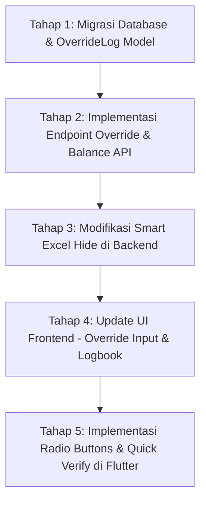

# Rencana Implementasi: Sistem Cash Bank Virtual, Excel Dynamic Hiding, Approval Override & Logbook

Rencana ini merinci langkah-langkah pengembangan untuk mengimplementasikan perubahan arsitektur keuangan, sistem persetujuan kustom, penyembunyian kolom kosong di Excel, dan pembaruan antarmuka (UI/UX) berdasarkan master plan ([MASTER_PLAN_CASH_BANK_ADVANCE.md](file:///D:/Aplikasi/EWIApps/docs/MASTER_PLAN_CASH_BANK_ADVANCE.md)) dan logika keuangan yang diarahkan.

---

## 1. Konsep "Rekening Bank Virtual" Karyawan (Pindah Kantong)

Untuk memperlakukan Kasbon (*Cash Advance*) sebagai dana titipan yang mengendap (bukan pengeluaran riil), kita akan menerapkan konsep saldo berjalan (*Running Balance*) virtual per karyawan.

**Filosofi Keuangan:**
Ibaratnya, perusahaan memindahkan uang dari "kantong utama" ke "rekening bank virtual" milik karyawan (misalnya "Bank Andi"). Karena uang tersebut belum dibelanjakan dan wujudnya masih berupa uang tunai di tangan karyawan, uang itu masih berstatus milik perusahaan. Uang kasbon yang dipegang karyawan statusnya akan terus "menggantung" sebagai **utang internal**. Jika karyawan *resign*, utang ini wajib dilunasi atau dipotong dari gaji terakhirnya.

### 🔧 Rencana Backend:
1. **Pengecualian Laporan Pengeluaran**:
   * Memastikan query agregasi laporan tahunan di [annual_data.py](file:///D:/Aplikasi/EWIApps/backend/routes/reports/annual_data.py) murni menghitung nilai `Expense` yang disetujui, dan **mengabaikan** nominal pada model `Advance`.
2. **Kalkulasi Running Balance**:
   * Membuat fungsi helper `calculate_user_running_balance(user_id, company)` di `backend/services/balance_service.py` (atau `backend/routes/reports/annual_helpers.py`):
     $$\text{Running Balance} = \sum (\text{Advance Disetujui}) - \sum (\text{Settlement Disetujui}) + \sum (\text{Pengembalian Dana})$$
     * **Starting Balance:** Akun baru selalu mulai dari **Rp 0**.
     * **Legacy Migration:** Untuk karyawan lama, masukkan saldo tunai yang mereka pegang sebagai transaksi Advance perdana.
     * **Jika Hasil Positif (+):** Muncul istilah **Balance to Employee** (Perusahaan membayar ke pegawai).
     * **Jika Hasil Negatif (-):** Muncul istilah **Sisa Advance** (Uang masih di tangan pegawai).
3. **Endpoint Baru**:
   * Menambahkan API Endpoint: `GET /api/users/<int:user_id>/active_advance_balance` untuk mengecek saldo "Bank Advance" personal.

### 📱 Rencana Frontend:
1. **Live Balance Display**:
   * Pada form pembuatan Settlement baru, tambahkan widget informasi di bagian atas/bawah yang menampilkan saldo sisa Kasbon karyawan secara real-time.
   * **Trigger Otomatis:** Saat user mengklik tombol "Total", sistem bertanya apakah ada Advance untuk dikurangi.
2. **Profile Balance Widget**:
   * Pada halaman **Pengaturan (Settings/Profile)**, tambahkan baris informasi baru di samping "Role", "No HP", atau "Tempat Kerja" yang menampilkan **"Bank Advance: Rp X.XXX.XXX"**.
   * Widget ini harus tersedia untuk semua role (Staff, Manager, Super Manager) agar setiap individu tahu sisa tanggung jawab uang yang mereka pegang.

---

## 2. Fitur "Smart Excel" (Hide Empty Columns)

Untuk menjaga laporan Excel tetap ringkas, kolom kategori yang tidak memiliki transaksi (total = 0) dalam rentang waktu laporan akan disembunyikan secara dinamis.

### 🔧 Rencana Backend:
1. **Penyederhanaan Kolom**:
   * Output laporan Excel difokuskan pada: **Tanggal, Deskripsi, Kategori, dan Total**.
2. **Logika Filter Kolom**:
   * Pada fungsi ekspor Excel di `backend/utils/excel_generator.py` (atau `fix_exports.py`), sebelum merender header kategori (Beban Langsung, Beban Tidak Langsung, Admin Umum), lakukan pengecekan total nilai per kategori.
   * Jika `total_kategori == 0`, kolom tersebut di-*skip* (tidak dibuat selnya) atau kolomnya di-*set hidden* menggunakan library `openpyxl`.

---

## 3. Reorganisasi Sidebar & Menu (Manajer Only)

Untuk mendukung pemisahan logika "Pindah Kantong", Sidebar akan menggunakan struktur **Parent Menu "BANK"**:

1.  **Parent: BANK**
    *   **Child 1: Bank Cash**: Mengelola saldo fisik bank, bunga, dan pengembalian sisa kasbon.
    *   **Child 2: Bank Advance**: Memantau saldo titipan (uang menggantung) per nama karyawan.
2.  **Menu Laporan**: Hanya fokus pada pengeluaran riil (Settlement).

---

## 4. Sistem Persetujuan (Approval Override) & Logbook Transparansi

### 🔧 Rencana Backend:
1. **Skema Database (Models)**:
   * Menambahkan model `OverrideLog` di [models.py](file:///D:/Aplikasi/EWIApps/backend/models.py) untuk mencatat riwayat perubahan nominal:
     ```python
     class OverrideLog(db.Model):
         id = db.Column(db.Integer, primary_key=True)
         item_id = db.Column(db.Integer, nullable=False) # ID Expense / Advance
         item_type = db.Column(db.String(50)) # 'expense' or 'advance'
         changed_by = db.Column(db.Integer, db.ForeignKey('users.id'))
         original_amount = db.Column(db.Float)
         revised_amount = db.Column(db.Float)
         changed_at = db.Column(db.DateTime, default=datetime.utcnow)
         notes = db.Column(db.Text)
     ```
2. **Modifikasi Endpoint Persetujuan**:
   * Di [settlements.py](file:///D:/Aplikasi/EWIApps/backend/routes/settlements.py) dan `advances.py` pada rute `/approve` atau `/final_approve`, izinkan *payload* opsional berisi nilai nominal yang direvisi:
     ```json
     {
       "approved_amount": 3500000.0,
       "override_notes": "Disesuaikan karena melebihi anggaran standar"
     }
     ```
   * Jika ada `approved_amount` yang berbeda dengan nominal awal, update nilainya di tabel transaksi utama, lalu simpan catatan perubahan tersebut ke `OverrideLog`.

### 📱 Rencana Frontend:
1. **Interactive Override Input**:
   * Pada layar persetujuan Manager di detail Kasbon atau Settlement, tambahkan field input nominal persetujuan (*Approved Amount*) yang secara default berisi nominal ajuan awal staf.
   * Manager dapat mengedit langsung angka tersebut sebelum menekan tombol **Setujui / Approve**.
2. **Logbook Panel (Toggle)**:
   * Tambahkan tombol "Lihat Riwayat Perubahan (Logbook)" di bagian bawah detail detail transaksi.
   * Saat ditekan, panel riwayat yang mengambil data dari `OverrideLog` API akan meluncur turun (*animated toggle panel*) memperlihatkan informasi: *Siapa yang merubah, kapan, nominal asal, nominal revisi, dan catatannya*.

---

## 5. UI/UX Refinement di Frontend

### 📱 Rencana Frontend:
1. **Radio Button Kategori**:
   * Pada dialog tambah item pengeluaran di [settlement_detail_screen.dart](file:///D:/Aplikasi/EWIApps/frontend/lib/screens/settlement/settlement_detail_screen.dart), ganti Checkbox/Multi-select dengan **Radio Button** untuk kategori tingkat akar, memaksa pengguna memilih tepat **satu** kategori untuk mencegah duplikasi input di sheet Excel.
2. **Quick Verify (List Approve/Reject)**:
   * Di dashboard persetujuan Manager, tambahkan tombol aksi cepat (Ikon Centang Hijau dan Silang Merah) di sisi kanan setiap baris ajuan list transaksi. Ini memungkinkan manager melakukan verifikasi instan satu klik untuk ajuan yang dinilai sudah standar tanpa harus masuk ke halaman detail.

---

## 📅 Rencana Tahapan Eksekusi:



### 🧪 Rencana Verifikasi:
* **Uji Laba Rugi**: Memastikan tidak ada data nominal kasbon awal yang bocor ke total pengeluaran di Sheet 2 dan Excel.
* **Uji Ekspor Excel**: Ekspor laporan bulanan dengan satu kategori kosong, pastikan kolom kategori tersebut tersembunyi dengan benar.
* **Uji Override**: Kurangi nominal ajuan kasbon staf dari 5 juta ke 3 juta oleh Manager, pastikan nominal ter-update di database utama dan logbook riwayat mencatat data aslinya.
