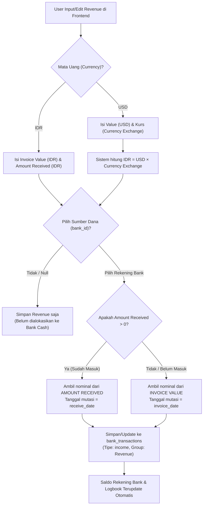

# Rencana & Analisis: Alur Pemindahan Uang ke Bank Cash & Konversi Kurs USD pada Transaksi Revenue

Dokumen ini menjelaskan secara komprehensif alur kerja (*data flow*), sumber kolom data, logika pemindahan uang ke **Bank Cash** (`BankTransaction`), serta mekanisme konversi mata uang **USD ke IDR** (dan kurs yang digunakan) pada modul **Revenue (Pemasukan)** di sistem EWI.

---

## 1. Alur Pemindahan Uang ke Bank Cash (Logbook Bank)

### A. Sumber Data & Pemicu (*Trigger*)
- **Tabel Sumber**: Tabel `revenues` (Data Pemasukan).
- **Pemicu Sinkronisasi**: Terjadi secara otomatis saat user memilih **"Sumber Dana (Bank Cash)"** (`bank_id`) pada saat **Tambah** atau **Edit** transaksi Revenue.
- **Handler Backend**: Fungsi `sync_revenue_bank_transaction(revenue, user_id=None, is_delete=False)` pada [`backend/routes/transactions/revenues.py`](file:///D:/Aplikasi/EWIApps/backend/routes/transactions/revenues.py).

### B. Berdasarkan Kolom Mana Nominalnya Dipindahkan? (Invoice Value vs Amount Received)
Pertanyaan kunci: *Apakah nominal pemindahan ke Bank Cash berdasarkan Invoice Value atau Amount Received?*

**Jawabannya**: **Memprioritaskan `AMOUNT RECEIVED` (Uang Riil yang Diterima), dengan Fallback ke `INVOICE VALUE` jika belum ada penerimaan.**

Logika pemilihannya di kode backend:
```python
# 1. Tentukan nominal Rupiah (amount_idr)
amount_idr = revenue.idr_amount_received
if amount_idr is None or amount_idr == 0:
    amount_idr = revenue.idr_invoice_value or 0.0

# 2. Tentukan nominal Valas/USD (amount_usd)
amount_usd = revenue.amount_received_usd
if amount_usd is None or amount_usd == 0:
    amount_usd = revenue.invoice_value_usd or 0.0
```

1. **Kondisi 1: Uang Sudah Diterima (`amount_received` > 0)**
   - Jika kolom **Amount Received** (baik IDR maupun USD) telah diisi (berarti klien sudah mentransfer dana ke rekening), maka sistem memasukkan angka **`amount_received`** ke mutasi Bank Cash.
   - Tanggal mutasi bank (`tx_date`): Menggunakan **`receive_date`** (Tanggal Uang Diterima).

2. **Kondisi 2: Uang Belum Diterima / Piutang Masih Berjalan (`amount_received` = 0 / kosong)**
   - Jika user sudah menetapkan rekening bank penampung (`bank_id`) tetapi `amount_received` masih kosong/0, sistem mengambil angka **`invoice_value`** sebagai estimasi saldo pemasukan.
   - Tanggal mutasi bank (`tx_date`): Menggunakan **`invoice_date`** (Tanggal Terbit Invoice).

3. **Kondisi 3: Revenue Dihapus atau `bank_id` Dikosongkan (`None`)**
   - Jika `bank_id` di-set ke `null` (belum dialokasikan ke rekening bank manapun), transaksi mutasi terkait di `bank_transactions` akan **dihapus** secara otomatis agar saldo bank tetap akurat.

### C. Pemetaan Nomor Kolom pada Tampilan "Tabel 1: PEMASUKAN" (Berdasarkan Screenshot)

Berdasarkan urutan kolom di **Tabel 1: PEMASUKAN** pada layar Laporan Tahunan:

| No. Kolom | Nama Kolom Header | Peran dalam Pemindahan ke Bank Cash |
|:---:|---|---|
| **Kolom 1** | `Invoice Date` | Cadangan (*fallback*) tanggal transaksi Bank Cash jika Kolom 10 kosong |
| **Kolom 2** | `#` | Nomor urut baris |
| **Kolom 3** | `Detail/Description` | Keterangan deskripsi mutasi di Bank Cash (`Penerimaan Revenue: {description}`) |
| **Kolom 4** | `INVOICE VALUE (child=USD)` | Cadangan nominal USD jika uang belum diterima (`amount_received_usd` kosong) |
| **Kolom 5** | `INVOICE VALUE (child=IDR)` | Cadangan nominal IDR jika uang belum diterima (`amount_received_idr` kosong) |
| **Kolom 6** | `Currency` | Mata uang transaksi (`IDR` atau `USD`) |
| **Kolom 7** | `Currency Exchange` | Nilai tukar / kurs per-transaksi untuk mengalikan USD ke IDR |
| **Kolom 8** | `INVOICE Number` | Nomor invoice penagihan |
| **Kolom 9** | `Client` | Nama klien/perusahaan penagihan |
| **Kolom 10** | `Receive Date` | **Prioritas Utama Tanggal Mutasi** di Bank Cash |
| **Kolom 11** | **`AMOUNT RECEIVED (child=IDR)`** | **PRIORITAS UTAMA NOMINAL RUPIAH** yang masuk ke mutasi Bank Cash |
| **Kolom 12** | **`AMOUNT RECEIVED (child=USD)`** | **PRIORITAS UTAMA NOMINAL USD** yang masuk ke mutasi Bank Cash |
| **Kolom 13** | `PPn (child=11%)` | Nilai pajak PPn |
| **Kolom 14** | `PPh (Pasal 23) (child=2%)` | Nilai potongan PPh 23 |
| **Kolom 15** | `Biaya transfer` | Biaya transfer perbankan |
| **Kolom 16** | **`Sumber Dana`** | **PENENTU MUTASI BANK CASH** (ID Rekening Bank tujuan transfer, misal BCA, Mandiri, dll.). Jika diisi "-", mutasi bank TIDAK DIBUAT. |
| **Kolom 17** | `Remark` | Keterangan tambahan (misal: "swasta", "Pemungut", dll.) |

> **Ringkasan Singkat untuk Pertanyaan Anda:**
> * Menentukan ke bank mana uangnya masuk: **Kolom 16 (Sumber Dana)**.
> * Mengambil nominal uang yang masuk: **Kolom 11 (AMOUNT RECEIVED IDR)** dan **Kolom 12 (AMOUNT RECEIVED USD)**.
> * Jika belum dibayar (Kolom 11 & 12 kosong), fallback mengambil dari: **Kolom 5 (INVOICE VALUE IDR)** dan **Kolom 4 (INVOICE VALUE USD)**.
> * Tanggal mutasi bank: **Kolom 10 (Receive Date)** (fallback ke Kolom 1 jika kosong).

---

### D. Pemetaan Kolom Data Revenue -> Bank Transaction (Tabel Database)
| Kolom di `revenues` | Kolom di `bank_transactions` | Keterangan |
|---|---|---|
| `bank_id` (Dropdown Sumber Dana) | `bank_id` | ID rekening bank penerima |
| `receive_date` / `invoice_date` | `date` | Tanggal transaksi di rekening bank |
| `description` | `description` | Label mutasi: `"Penerimaan Revenue: {description}"` |
| `idr_amount_received` / `idr_invoice_value` | `amount_idr` | Nominal mutasi dalam Rupiah |
| `amount_received_usd` / `invoice_value_usd` | `amount_usd` | Nominal mutasi dalam USD (jika transaksi valas) |
| *"Revenue"* | `group_name` | Kategori mutasi bank |
| *"income"* | `transaction_type` | Tipe mutasi: Uang Masuk (Kredit) |
| `company` | `company` | Entitas perusahaan |
| `report_year` | `report_year` | Tahun buku/laporan |
| `user_id` | `user_id` | Pengguna yang menginput/mengubah data |
| `id` | `revenue_id` | Relasi *Foreign Key* ke tabel `revenues` |

---

## 2. Transaksi USD & Mekanisme Konversi Kurs ke Rupiah

### A. Apakah Dolar Dikonversi ke Rupiah?
**YA, pasti dikonversi ke Rupiah.**
Sistem EWI menggunakan arsitektur **Dual-Currency (Dua Mata Uang Berdampingan)**:
1. Nominal asli USD disimpan di kolom `invoice_value_usd` dan `amount_received_usd`.
2. Nominal hasil konversi Rupiah disimpan di `invoice_value_idr` dan `amount_received_idr`.
3. Pada **Laporan Tahunan (Tabel 1 & Kartu Ringkasan Pemasukan)**:
   - Kartu metrik di atas tabel (misalnya total Rp 1.789.786.869) dan laporan Laba Rugi dihitung dari nilai **Rupiah (`idr_amount_received` / `idr_invoice_value`)**.

### B. Kurs Mana yang Digunakan?
Kurs yang digunakan adalah **kurs riil per-transaksi** yang diinputkan pengguna pada kolom **`Currency Exchange`** (`currency_exchange`).

Formula konversi pada model `Revenue` ([`backend/models/transaction.py`](file:///D:/Aplikasi/EWIApps/backend/models/transaction.py)):
```python
@property
def idr_invoice_value(self):
    if self.invoice_value_idr is not None:
        return self.invoice_value_idr
    if self.currency != "IDR" and self.currency_exchange:
        return self.invoice_value * self.currency_exchange
    return self.invoice_value

@property
def idr_amount_received(self):
    if self.amount_received_idr is not None:
        return self.amount_received_idr
    if self.currency != "IDR" and self.currency_exchange:
        return self.amount_received * self.currency_exchange
    return self.amount_received
```

### C. Catatan Kasus Khusus (Studi Kasus Baris 1: Nesitor pada Screenshot)
Pada screenshot yang Anda lampirkan:
- **Client**: `Nesitor`
- **INVOICE VALUE (USD)**: `4.650`
- **INVOICE VALUE (IDR)**: `4.650`
- **Currency**: `USD`
- **Currency Exchange**: `1`  *(Nilai tukar diinput 1)*
- **AMOUNT RECEIVED (USD)**: `5.069`
- **AMOUNT RECEIVED (IDR)**: `5.069`

**Penjelasan Kasus**:
Karena kolom **`Currency Exchange`** bernilai **1**, perkalian konversinya menjadi `4.650 * 1 = Rp 4.650` (dan amount received `5.069 * 1 = Rp 5.069`). Seharusnya, jika nilai tukar USD saat itu misalnya Rp 16.000 / USD, maka:
- `Currency Exchange`: diisi `16.000`
- `INVOICE VALUE (IDR)`: `4.650 * 16.000 = Rp 74.400.000`
- `AMOUNT RECEIVED (IDR)`: `5.069 * 16.000 = Rp 81.104.000`

---

## 3. Diagram Alur Transaksi (Mermaid Flowchart)



---

## 4. Daftar Tugas & Rekomendasi (Task Checklist)

- [x] **Identifikasi Sumber Kolom & Alur Bank Cash**: Pemetaan detail ke Kolom 16 (Sumber Dana), Kolom 11 & 12 (Amount Received IDR/USD), dan Kolom 4 & 5 (Invoice Value).
- [x] **Dokumentasi Formula Konversi Kurs**: Nilai tukar diambil dari `currency_exchange` per-baris transaksi.
- [x] **Audit Kode Backend & Frontend**: Menjamin `sync_revenue_bank_transaction` mengalirkan `amount_idr` dan `amount_usd` secara sinkron.
- [x] **Validasi UX pada Form Frontend (Selesai Diimplementasikan)**:
  - Auto-kalkulasi field IDR ketika nominal USD dan Currency Exchange diinput di modal dialog (`recalcDualCurrency()`).
  - Warning banner peringatan kuning jika user memilih currency `USD` tetapi `Currency Exchange` masih bernilai `1` atau kosong.
  - Dialog konfirmasi saat klik simpan jika kurs USD masih bernilai 1 atau kosong untuk mencegah kesalahan Rp 4.650 pada $4.650 USD.

