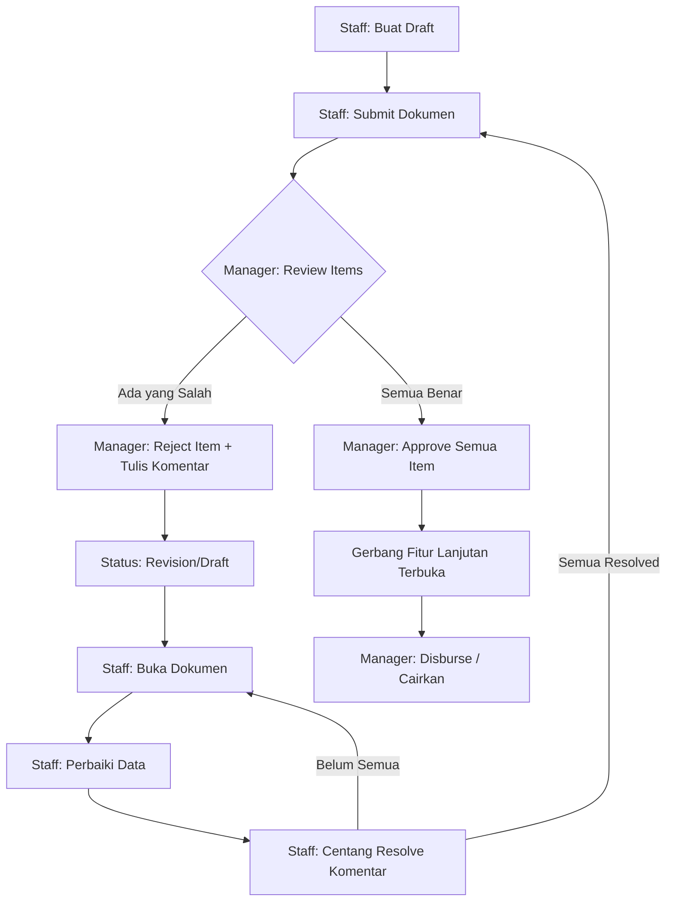

# Phase 3: User Flow Reconstruction

**Tujuan:** Memetakan *User Journey* tingkat aplikasi (*high-level*) dari sudut pandang interaksi pengguna, perpindahan halaman, hingga perpindahan peran (*role hand-off*). Fase ini tidak membedah logika internal form per fitur, melainkan memetakan aliran sistem secara keseluruhan.

---

## 1. Core Application Journey (End-to-End)

Secara garis besar, aplikasi dirancang sebagai *workspace* finansial berjenjang dengan siklus: **Akses ➔ Eksplorasi ➔ Eksekusi ➔ Persetujuan ➔ Eskalasi Modul**.

### A. Gate 1: Authentication & Context
1. **[LOGIN]** User membuka aplikasi. Sistem (melalui `AuthProvider`) memvalidasi sesi JWT lokal. Jika tidak ada, pengguna masuk lewat `LoginScreen` (Email/Google).
2. **[COMPANY]** Setelah login, pengguna diarahkan ke `DashboardScreen` (Company Selector).
   *   *Bypass Logic:* Jika user hanya tergabung di 1 perusahaan, sistem melompat langsung ke langkah berikutnya.
   *   *Selection Logic:* User memilih kartu perusahaan.
3. **[MAIN MENU]** Pengguna tiba di `MainLayout`. Data yang ditampilkan di seluruh sistem kini dikunci (*filtered*) berdasarkan ID Perusahaan yang dipilih.

### B. Gate 2: Feature Selection & Role Gating
4. **[SIDEBAR / NAV]** `MainLayout` menyajikan menu berdasarkan hak akses *role* (UI Gating).
   *   *Staff / Mitra Eks* hanya melihat `Pertanggungjawaban` (Settlement), `Kasbon` (Advance), dan `Pengaturan`.
   *   *Manager / Super Manager* melihat tambahan fitur `Laporan`, `Kategori`, dan `Bank Management`.
5. **[USER MEMILIH FITUR]** Pengguna mengeklik salah satu modul, misalnya **Kasbon**. Sistem merender `AdvancesScreen` berisi daftar dokumen miliknya (jika Staff) atau semua orang (jika Manager).

### C. Gate 3: Action, Validation, & Status
6. **[ACTION]** Pengguna membuat pengajuan baru atau membuka draf dokumen. Mereka mengisi form input dasar.
7. **[VALIDATION]** Frontend dan Backend memvalidasi kelengkapan data (contoh: wajib ada minimal 1 *item* pengeluaran sebelum bisa Submit).
8. **[STATUS]** Setelah *Submit*, dokumen terkunci sementara bagi *Owner*. Status berubah menjadi `submitted`.

### D. Gate 4: Role Hand-off & Approval Loop
9. **[ROLE BERIKUTNYA]** Bola berpindah ke `Manager`. Sistem *polling* notifikasi memberitahu Manager ada dokumen baru. Manager membuka dokumen yang sama via *dashboard*-nya.
10. **[APPROVE / REJECT]** Manager melakukan pemeriksaan.
    *   Jika **Setuju** ➔ Manager menekan *Approve* pada rincian data.
    *   Jika **Menolak** ➔ Manager menekan *Reject* dan diwajibkan mengisi komentar perbaikan (Rejection Note).
11. **[CORRECTION LOOP]** Jika ada penolakan, bola kembali ke *Owner*. Dokumen kembali berstatus `draft` / `revision`. *Owner* harus membaca komentar, memperbaiki data, dan mencentang *checkbox* (Resolve Comment).
12. **[SUBMIT AGAIN]** Setelah semua komentar diselesaikan (*resolved*), *Owner* menekan Submit kembali. Kembali ke langkah 9 (Looping).

### E. Gate 5: Gating & Next Module (Business Escalation)
13. **[GATE UNLOCKED]** Jika seluruh *item* akhirnya di-*Approve* (kondisi `isManagerApproved == true`), gerbang fitur finansial lanjutan (seperti Tabel Pencairan / *Disbursement*) terbuka.
14. **[FINAL STATUS]** Manager mencairkan dana. Dokumen berstatus `disbursed` / `completed`.
15. **[NEXT MODULE]** Siklus selesai di satu fitur, namun menjadi *input* atau prasyarat untuk fitur berikutnya. (Contoh: Selesainya Kasbon mewajibkan pengguna memulai siklus baru di fitur **Pertanggungjawaban/Settlement**).

---

## 2. Peta Loop Persetujuan (The Rejection-Correction Loop)

*Pattern* aplikasi ini sangat menekankan *Correction Loop* yang ketat (berbasis komentar baris per baris), dibandingkan dengan model *Reject-All* tradisional.

---

*Phase 3 ini memetakan kerangka arsitektur pengalaman pengguna di tingkat makro. Selanjutnya, Phase 4 (Feature Flow) akan membedah mekanika internal per halaman fitur secara sangat terperinci (termasuk perilaku spesifik Tabel 1, 2, dan 3 pada Kasbon).*
