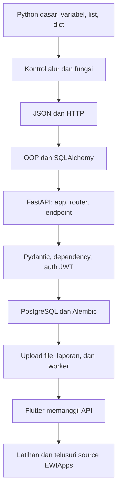

# Roadmap Belajar Python & FastAPI untuk EWIApps

Roadmap ini menggantikan kurikulum Flask lama. Aplikasi aktif EWIApps menggunakan **FastAPI** untuk backend dan **Flutter** untuk frontend. Flask hanya dapat muncul pada catatan atau snapshot historis; jangan gunakan Flask sebagai framework untuk fitur baru.

Tujuan belajar: memahami fondasi Python, alur request Flutter ke FastAPI, database SQLAlchemy, dan fitur laporan yang digunakan aplikasi.

## 1. Pemilihan Buku

| Buku | Pemakaian dalam roadmap |
| --- | --- |
| `00. Dasar-Dasar Python untuk Data Science.PDF` | Sumber utama untuk sintaks, struktur data, fungsi, OOP, error handling, dan Pandas. |
| `Python Notes For Profs.pdf` | Gunakan bagian database/SQL sebagai pengantar. Chapter Flask bukan materi framework untuk EWIApps; ganti dengan latihan FastAPI di roadmap ini. |
| `Python All-In-One for Dummies` | Referensi tambahan untuk JSON, exception, dan konsep Python yang belum jelas. |
| `Practical Statistics For Data Scientists` | Opsional untuk analisis data; bukan prasyarat memahami backend API. |
| `Data Structures and Algorithms in Python` | Opsional; pelajari bila membutuhkan dasar algoritma lebih lanjut. |
| `Beginning Programming with Python for Dummies` | Referensi alternatif untuk pemula, tidak perlu dibaca jika materi dasar sudah dipahami. |

Nomor halaman buku mengikuti edisi yang dicatat sebelumnya. Cocokkan dengan daftar isi PDF yang tersedia karena nomor halaman dapat berbeda antar edisi.

## 2. Urutan Belajar

## 3. Langkah Praktik

### Langkah 1 — Python dasar

Pelajari variabel, tipe data, `list`, `dict`, kondisi, perulangan, dan fungsi. Fokus pada `dict` karena payload API dan hasil JSON sering direpresentasikan sebagai dictionary Python.

**Latihan:** buat fungsi yang menghitung total pengajuan kasbon dari daftar dictionary dan menolak nominal negatif.

### Langkah 2 — Fungsi, error, JSON, dan HTTP

Pelajari parameter/return, `try`/`except`, logging, JSON, HTTP method, status code, header, query parameter, dan body. Flutter mengirim request dan membaca response melalui API; JSON adalah format datanya.

**Latihan:** susun contoh payload transaksi JSON, validasi field wajib, lalu jelaskan perbedaan status `200`, `201`, `400`, `401`, dan `404`.

### Langkah 3 — OOP dan database

Pelajari class, object, constructor, relasi tabel, primary key, foreign key, session, transaksi, commit, dan rollback. EWIApps memakai SQLAlchemy langsung. Beberapa model mempertahankan nama kompatibilitas `db.Model`/`db.Column` melalui adapter internal; itu bukan paket Flask-SQLAlchemy atau runtime Flask.

**Rujukan proyek:** `backend/models/`, `backend/core/database.py`, dan `backend/migrations/`.

### Langkah 4 — FastAPI dasar

Pelajari pembuatan `FastAPI`, `APIRouter`, path operation (`@router.get`, `@router.post`, dan seterusnya), path/query parameter, body, response, serta `HTTPException`. Endpoint adalah fungsi Python yang menerima input terdefinisi dan mengembalikan response.

**Rujukan proyek:** `backend/main.py` dan modul di `backend/routes/`. Jalankan server pengembangan sesuai README proyek, lalu buka `/docs` untuk mencoba OpenAPI UI.

### Langkah 5 — Validasi, dependency, dan keamanan

Pelajari model Pydantic, `Depends`, dependency database, autentikasi bearer, role check, dan JWT. EWIApps tetap menggunakan JWT melalui PyJWT dan dependency FastAPI; JWT adalah mekanisme autentikasi, bukan Flask.

**Rujukan proyek:** `backend/core/security.py`, `backend/routes/core/auth_fastapi.py`, dan `backend/schemas/`.

### Langkah 6 — Database, file, dan laporan

Pelajari query SQLAlchemy, Alembic, validasi upload (`UploadFile`), penyimpanan file, ekspor Excel (OpenPyXL/XlsxWriter), PDF (ReportLab), serta Pandas untuk audit data.

**Rujukan proyek:** `backend/services/`, `backend/routes/reports/`, `backend/migrations/`, dan `backend/scripts/`.

### Langkah 7 — Integrasi Flutter

Telusuri service API Flutter untuk melihat base URL, header bearer token, JSON, multipart upload, timeout, dan penanganan error HTTP. Ikuti satu fitur dari layar Flutter → service API → router FastAPI → service/database.

**Rujukan proyek:** `frontend/lib/services/` dan `frontend/lib/screens/`.

## 4. Pola Belajar

Untuk setiap langkah:

1. Pelajari konsep yang disebutkan, tanpa membaca banyak bab yang tidak diperlukan.
2. Jalankan contoh kecil terpisah dari data produksi.
3. Buat latihan kasbon/transaksi yang memakai konsep tersebut.
4. Telusuri satu implementasi EWIApps yang relevan dan catat alur input hingga output.
5. Untuk perubahan kode, ikuti tes dan instruksi proyek yang berlaku.

**Catatan:** dokumen ini menggantikan `roadmap_belajar_python_flask.md` sebagai roadmap FastAPI. Nama file dipertahankan agar referensi/link lama tidak putus.
