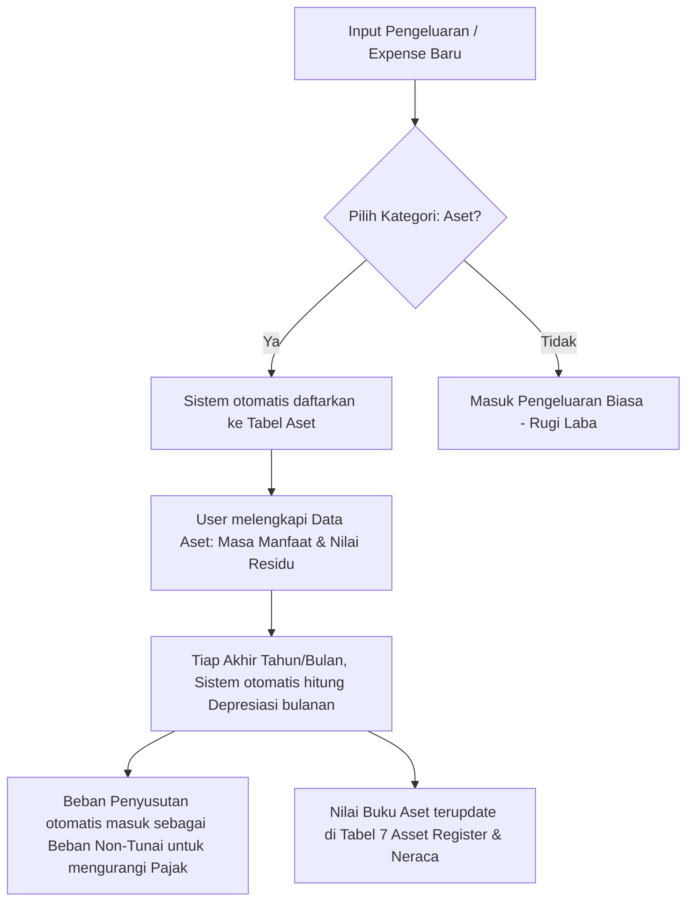

# Panduan Lengkap & Rumus Perhitungan Asset Register (Sistem Depresiasi Aset)

Dokumen ini menjelaskan secara rinci tentang **logika, skema database, rumus matematika, kode implementasi, serta contoh nyata** perhitungan depresiasi aset pada aplikasi **MiniProject KPI EWI**.

---

## 1. Konsep Dasar Asset Register & Depresiasi
Dalam akuntansi, pembelian barang mahal yang memiliki masa pakai panjang (seperti mobil, laptop, gedung, mesin) tidak boleh langsung diakui sebagai biaya operasional biasa di bulan pembelian. Barang-barang ini dicatat sebagai **Aset Tetap (Fixed Assets)**.

Nilai aset ini akan berkurang seiring waktu karena pemakaian, usia, atau perkembangan teknologi. Pengurangan nilai ini disebut **Depresiasi (Penyusutan)**.
* **Manfaat Akuntansi:** Membagi beban biaya aset secara adil selama masa manfaatnya.
* **Manfaat Pajak:** Beban penyusutan bulanan/tahunan secara legal mengurangi Laba Bersih sebelum pajak (EBT), sehingga **mengurangi kewajiban pajak perusahaan**.
* **NPV (Net Present Value/Nilai Buku Saat Ini):** Mengetahui nilai riil seluruh kekayaan fisik perusahaan jika dinilai hari ini.

---

## 2. Skema Database Aset (Model `Asset`)
Di bagian backend (`backend/models.py`), data aset disimpan dalam tabel `assets` dengan kolom-kolom sebagai berikut:

| Nama Kolom di DB | Tipe Data | Keterangan |
| :--- | :--- | :--- |
| `id` | `Integer` | ID unik database (Primary Key). |
| `asset_code` | `String(50)` | Kode unik identifikasi aset (contoh: `AST-2026-001`). |
| `name` | `String(200)` | Nama barang/aset (contoh: `Toyota Avanza Veloz`). |
| `purchase_date` | `Date` | Tanggal pembelian/perolehan aset. |
| `purchase_price` | `Float` | **Nilai Perolehan** (harga beli awal aset dalam rupiah). |
| `useful_life_months`| `Integer` | **Masa Manfaat** dalam hitungan bulan (contoh: 4 tahun = 48 bulan). |
| `residual_value` | `Float` | **Nilai Sisa/Residu** (estimasi nilai aset setelah masa manfaat habis, default: `0`). |
| `asset_type` | `String(50)` | Jenis aset (contoh: `Kendaraan`, `Elektronik`, `Peralatan`). |
| `status` | `String(20)` | Status operasional aset (`Active`, `Sold`, `Damaged`, `Disposed`). |
| `description` | `Text` | Catatan/keterangan tambahan. |

---

## 3. Rumus Matematika Depresiasi (Metode Garis Lurus)
Sistem ini menggunakan metode penyusutan **Garis Lurus (Straight-Line Method)**, di mana beban penyusutan bernilai sama setiap bulannya selama masa manfaat aset berjalan.

Berikut adalah 4 rumus utama yang dijalankan oleh sistem:

### Rumus A: Beban Penyusutan Bulanan (Monthly Depreciation)
$$Penyusutan\ Bulanan = \frac{Nilai\ Perolehan}{Masa\ Manfaat\ (Bulan)}$$
Jika ditulis dalam variabel database:
$$\text{monthly\_depreciation} = \frac{\text{purchase\_price}}{\text{useful\_life\_months}}$$

> [!NOTE]
> Jika masa manfaat (`useful_life_months`) bernilai 0, maka penyusutan bulanan otomatis bernilai 0 untuk menghindari pembagian dengan angka nol (*division by zero*).

---

### Rumus B: Jumlah Bulan Berjalan (Months Passed)
Sistem menghitung berapa bulan masa penyusutan yang telah dilalui dihitung dari **Tanggal Pembelian** (`purchase_date`) hingga **Tanggal Laporan** (`report_date` - diasumsikan 31 Desember dari tahun laporan yang aktif):

1. Jika **Tanggal Pembelian > Tanggal Laporan**, aset belum dimiliki pada periode laporan tersebut:
   $$\text{months\_passed} = 0$$

2. Jika sudah dimiliki, jumlah bulan dihitung dengan formula:
   $$\text{months\_passed} = ((\text{Tahun Laporan} - \text{Tahun Pembelian}) \times 12) + (\text{Bulan Laporan} - \text{Bulan Pembelian}) + 1$$

3. Jumlah bulan berjalan **tidak boleh melebihi** masa manfaat maksimum aset tersebut:
   $$\text{months\_passed} = \min(\text{months\_passed},\ \text{useful\_life\_months})$$

---

### Rumus C: Akumulasi Penyusutan (Accumulated Depreciation)
Total nilai penyusutan yang telah dikumpulkan sejak aset dibeli hingga tanggal laporan:
$$Akumulasi\ Penyusutan = Penyusutan\ Bulanan \times Bulan\ Berjalan$$
$$\text{accumulated\_depreciation} = \text{monthly\_depreciation} \times \text{months\_passed}$$

---

### Rumus D: Nilai Buku Akhir (Book Value)
Nilai sisa aset saat ini yang dicatat di neraca setelah dikurangi akumulasi penyusutan. Nilai buku akhir **tidak boleh lebih rendah** dari Nilai Sisa/Residu (`residual_value`):
$$Nilai\ Buku = \max(Nilai\ Perolehan - Akumulasi\ Penyusutan,\ Nilai\ Sisa)$$
$$\text{book\_value} = \max(\text{purchase\_price} - \text{accumulated\_depreciation},\ \text{residual\_value})$$

---

## 4. Logika Kode Backend (Python)
Dalam file `backend/routes/reports/annual_data.py`, fungsi yang menghitung rumus di atas diimplementasikan secara dinamis sebagai berikut:

```python
def _calculate_asset_depreciation(assets, year):
    asset_data = []
    for a in assets:
        ad = a.to_dict()
        purchase_date = a.purchase_date
        report_date = date(year or datetime.now().year, 12, 31)
        
        # 1. Menentukan bulan berjalan (months_passed)
        if purchase_date > report_date:
            months_passed = 0
        else:
            months_passed = (
                (report_date.year - purchase_date.year) * 12
                + (report_date.month - purchase_date.month)
                + 1
            )
            # Membatasi agar tidak melebihi masa manfaat aset
            months_passed = min(months_passed, a.useful_life_months)

        # 2. Menghitung penyusutan bulanan
        monthly_depreciation = (
            a.purchase_price / a.useful_life_months if a.useful_life_months > 0 else 0
        )
        
        # 3. Menghitung akumulasi penyusutan
        accumulated_depreciation = monthly_depreciation * months_passed
        
        # 4. Menghitung nilai buku akhir (tidak boleh di bawah nilai residu)
        book_value = max(a.purchase_price - accumulated_depreciation, a.residual_value)

        # Menyimpan hasil kalkulasi ke dalam dictionary data laporan
        ad["monthly_depreciation"] = monthly_depreciation
        ad["accumulated_depreciation"] = accumulated_depreciation
        ad["book_value"] = book_value
        asset_data.append(ad)
        
    return asset_data
```

---

## 5. Simulasi & Contoh Perhitungan Nyata

### 💻 Kasus A: Pembelian Laptop Asus ROG (Tanpa Nilai Sisa)
* **Nama Aset:** Laptop Asus ROG
* **Tanggal Pembelian:** 15 Maret 2025
* **Harga Beli (Nilai Perolehan):** Rp 24.000.000
* **Masa Manfaat:** 4 Tahun (48 Bulan)
* **Nilai Sisa (Residu):** Rp 0
* **Tahun Laporan Posisi:** Akhir Tahun 2025 (`31 Desember 2025`)

**Kalkulasi:**
1. **Penyusutan Bulanan:**
   $$\text{monthly\_depreciation} = \frac{24.000.000}{48\text{ Bulan}} = \text{Rp } 500.000\text{ / bulan}$$

2. **Jumlah Bulan Berjalan (15 Mar 2025 s.d 31 Des 2025):**
   $$\text{months\_passed} = ((2025 - 2025) \times 12) + (12 - 3) + 1 = 0 + 9 + 1 = 10\text{ bulan}$$

3. **Akumulasi Penyusutan (Tahun 2025):**
   $$\text{accumulated\_depreciation} = 500.000 \times 10 = \text{Rp } 5.000.000$$

4. **Nilai Buku Akhir (Tahun 2025):**
   $$\text{book\_value} = \max(24.000.000 - 5.000.000,\ 0) = \text{Rp } 19.000.000$$

*Maka pada Laporan Akhir Tahun 2025, Laptop ini tercatat memiliki Nilai Buku sebesar **Rp 19.000.000** dengan total penyusutan tahun berjalan sebesar **Rp 5.000.000**.*

---

### 🚗 Kasus B: Pembelian Mobil Operasional Box (Dengan Nilai Sisa)
* **Nama Aset:** L300 Pick Up Box
* **Tanggal Pembelian:** 10 Juni 2024
* **Harga Beli (Nilai Perolehan):** Rp 160.000.000
* **Masa Manfaat:** 8 Tahun (96 Bulan)
* **Nilai Sisa (Residu):** Rp 40.000.000 (diasumsikan setelah 8 tahun mobil box rongsok masih laku dijual Rp 40 juta)
* **Tahun Laporan Posisi:** Akhir Tahun 2026 (`31 Desember 2026`)

**Kalkulasi:**
1. **Penyusutan Bulanan:**
   $$\text{monthly\_depreciation} = \frac{160.000.000}{96\text{ Bulan}} = \text{Rp } 1.666.666,67\text{ / bulan}$$

2. **Jumlah Bulan Berjalan (10 Juni 2024 s.d 31 Des 2026):**
   * Tahun 2024 (Juni s.d Des) = 7 bulan
   * Tahun 2025 (Jan s.d Des) = 12 bulan
   * Tahun 2026 (Jan s.d Des) = 12 bulan
   $$\text{months\_passed} = ((2026 - 2024) \times 12) + (12 - 6) + 1 = 24 + 6 + 1 = 31\text{ bulan}$$

3. **Akumulasi Penyusutan (Tahun 2026):**
   $$\text{accumulated\_depreciation} = 1.666.666,67 \times 31 = \text{Rp } 51.666.666,77$$

4. **Nilai Buku Akhir (Tahun 2026):**
   $$\text{book\_value} = \max(160.000.000 - 51.666.666,77,\ 40.000.000) = \text{Rp } 108.333.333,23$$

*Maka pada Laporan Akhir Tahun 2026, Mobil L300 tercatat memiliki Nilai Buku sebesar **Rp 108.333.333,23**.*

---

## 6. Alur Kerja Integrasi Aset di Aplikasi
Agar sistem dapat bekerja dengan otomatis dan efisien tanpa entri data ganda, alurnya dirancang sebagai berikut:



1. **Input Transaksi:** Saat staf melakukan input di menu **Pengeluaran (Expense)**, staf memilih kategori **Aset**.
2. **Auto-Register:** Sistem secara cerdas akan langsung membuat baris baru di **Asset Register** secara otomatis dengan menduplikasi nama transaksi, harga beli, dan tanggal perolehan.
3. **Konfigurasi Aset:** Manager/Admin tinggal membuka menu **Asset Management** untuk melengkapi kolom `Masa Manfaat (useful_life_months)` dan `Nilai Residu (residual_value)`.
4. **Output Laporan:** Laporan Tahunan secara otomatis mengalkulasi seluruh aset terdaftar, menyajikan **Tabel 6 (Asset Register)** yang lengkap, serta memindahkan beban depresiasi ke perhitungan pajak tahunan secara *real-time*.

---

## 7. Penjelasan Versi Awam (Sangat Sederhana & Mudah Dipahami)

Jika Anda harus menjelaskan konsep ini ke orang lain yang **belum paham akuntansi atau matematika rumit**, gunakan analogi sederhana berikut ini:

### 📱 Analogi Sederhana: "Beli Handphone Baru"

Bayangkan Anda membeli **Handphone baru seharga Rp 12 Juta** hari ini untuk operasional kerja.

* **Apakah HP itu langsung dianggap "uang hangus" hari ini seperti Anda beli bakso?**
  **Tentu tidak.** Bakso kalau dimakan langsung habis hari itu juga (ini namanya *Pengeluaran Biasa*). Sedangkan HP fisiknya masih ada di tangan Anda, masih bagus, dan bisa dipakai untuk bekerja sampai bertahun-tahun ke depan (ini namanya **Aset / Harta Kekayaan**).

* **Tapi, apakah harga HP itu 2 tahun lagi masih Rp 12 Juta jika mau dijual?**
  **Pasti turun.** Misalkan harganya menyusut sisa Rp 6 Juta saja karena sudah bekas dipakai. Penurunan harga barang secara perlahan karena usia dan pemakaian inilah yang disebut **Depresiasi (Penyusutan)**.

---

### 💡 4 Istilah Gampang dalam Sistem Aset

Untuk mencatat HP tersebut di aplikasi, sistem hanya butuh 4 informasi sederhana ini:

1. **Harga Beli Awal (Nilai Perolehan):** 
   Uang pertama yang dikeluarkan saat beli barang. (Contoh: **Rp 12 Juta**).
2. **Umur Barang (Masa Manfaat):** 
   Perkiraan berapa lama barang itu layak dipakai kerja sebelum akhirnya rusak atau harus ganti baru. (Contoh: Diperkirakan awet selama **4 Tahun / 48 Bulan**).
3. **Penyusutan Bulanan:** 
   Penurunan nilai barang yang dibagi rata secara adil setiap bulannya.
   * *Cara hitung gampang:* HP seharga Rp 12 Juta dibagi 48 bulan masa pakai = **Rp 250 Ribu per bulan**. 
   * Jadi, sistem menganggap HP Anda "luntur" nilainya sebesar Rp 250 Ribu setiap bulan.
4. **Harga Wajar Saat Ini (Nilai Buku):** 
   Sisa nilai barang Anda di pembukuan setelah dikurangi penyusutan yang sudah berjalan.
   * *Contoh:* Setelah dipakai selama **10 Bulan**, total nilai susutnya adalah $10 \times \text{Rp 250 Ribu} = \text{Rp 2,5 Juta}$.
   * Maka, nilai HP Anda saat ini di pembukuan adalah $\text{Rp 12 Juta} - \text{Rp 2,5 Juta} = \text{Rp 9,5 Juta}$ (**Nilai Buku**).

---

### 🎯 Kenapa Sistem Ini Sangat Penting Bagi Bisnis Papa/Om Anda?

Ada dua alasan utama mengapa sistem ini wajib ada di perusahaan:

#### 1. Hemat Pajak Secara Legal (Tax Shield)
Pemerintah mengizinkan nilai "Penyusutan Bulanan" tadi (yang Rp 250 Ribu sebulan) dimasukkan ke dalam **Beban Biaya Perusahaan**.
* *Efeknya:* Di atas kertas, keuntungan bersih perusahaan terlihat mengecil karena ada tambahan beban penyusutan barang.
* Karena keuntungan di laporan terlihat lebih kecil secara sah/legal, **pajak penghasilan badan yang harus dibayarkan perusahaan ke negara otomatis menjadi jauh lebih murah/hemat!** Padahal, uang kas riil perusahaan tidak berkurang di bulan itu (karena HP sudah dibayar lunas di awal).

#### 2. Mengetahui Kekayaan Fisik Kantor yang Sebenarnya
Papa/Om Anda bisa langsung memantau nilai kekayaan kantor secara akurat. Jika ada yang bertanya, *"Kalau semua barang di kantor saya (mobil, laptop, AC, printer) dijual hari ini, kira-kira total harganya masih laku berapa ya?"*, Papa tinggal melihat kolom **Total Nilai Buku (Book Value)** di aplikasi.
